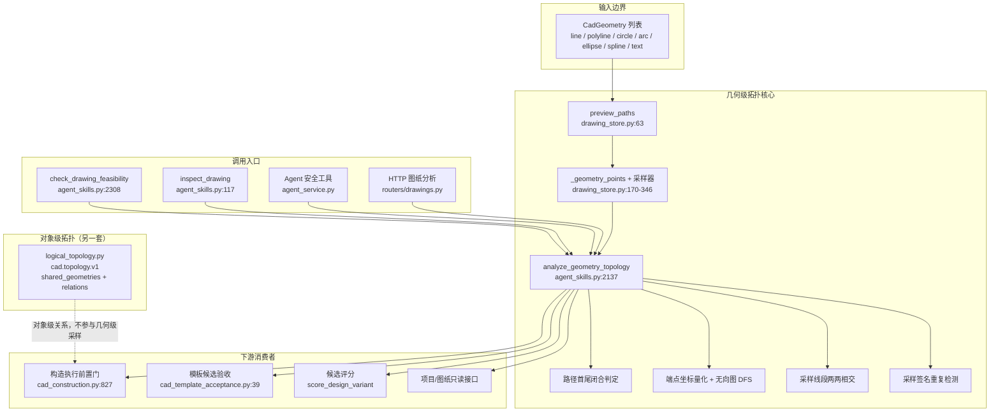

# R1 几何拓扑能力只读审计报告

- 报告版本：R1-AUDIT-v1（只读审计）+ R1-A 实施验收记录
- 审计日期：2026-11-16
- 审计对象：恢复仓库 `backend` 当前基线
- 基线 HEAD：`b065326b6eefd3d53fe756d85f5334d5778dcc15`
- 全量测试基线：R0 为 1684 passed / 0 failed / 4 skipped / 62 subtests；R1-A 后为 1691 passed / 0 failed / 4 skipped / 62 subtests
- 审计范围：第 0–15 节为 R1-01 至 R1-07 只读审计；第 16 节为 R1-A 实施与 G1-A 验收追加记录
- 审计性质：第 0–15 节只读；R1-A 仅修改 `app/agent_skills.py` 与新增 `tests/test_geometry_topology_graph.py`，未解冻 Engine，未接入 Translate 路由，未修改 P1.9 Gold，未 Push 远程。
- 工作树状态：`main` 仍为基线 `b065326...`；R1-A 在 `r1/topology-foundation` 提交 `84ba1e49...`；工作树干净。

## 结论标签

本报告每项结论按以下四类标注：

- **已由代码证明**：由当前源码、模型定义或调用关系直接证明；必要时附本轮只读探针复核。
- **已由测试证明**：由当前仓库中已存在的测试函数直接覆盖并通过基线。
- **尚待实现**：当前仓库没有对应能力、类型、字段或调用链，需要后续授权后建设。
- **尚待验证**：代码可读或可推断，但缺少测试、实测数据、误差证明或 P2.0 契约裁定，不能写成既成事实。

---

## 0. 执行摘要

### 0.1 一句话结论

现有 `analyze_geometry_topology` 是一个**采样折线端点图 + 采样线段两两相交 + 采样签名重复**的轻量检查器，不是解析几何拓扑引擎；它能覆盖直线和少量闭合折线场景，但不能直接承担 P2.0 的几何连接节点、解析求交、`CubicBezier` 一等类型、可信 Junction 容差和 `extension_of` 延长链。

**结论：已由代码证明。**

### 0.2 已具备、不应重复实现的能力

| 能力 | 现状 | 结论 |
|---|---|---|
| 直线、折线的精确线段输入 | `line` 两端点、`polyline` 顶点直接成为拓扑线段 | 已由代码证明 |
| 单条路径的首尾闭合判定 | 首尾采样点距离 ≤ `tolerance_mm` 即计闭合 | 已由代码证明 |
| 采样折线的连通分量计数 | 端点坐标按容差量化后建无向图 DFS | 已由代码证明 |
| 同一路径采样线段自交 | 两两线段方向叉积 + 共线包围盒判断 | 已由代码证明 |
| 跨路径采样线段交叉计数 | 只告警，不进入阻断错误 | 已由代码证明 |
| 整条路径的重复几何检测 | 采样点序列按 1 mm 量化后做正/反向、闭合环循环移位规范化 | 已由代码证明 |
| 对象级共享边界与八种空间关系 | `app/logical_topology.py` 的 `cad.topology.v1` | 已由代码证明 |
| 构造层复合路径的 C0/C1、自交、重复段、采样误差可配置与报告 | `app/cad_construction.py` 的复合路径质量检查 | 已由代码证明 |

### 0.3 真正缺失、会阻断 P2.0 的能力

1. **图级开链/闭链识别缺失**：`open_chain_count`、`closed_loop_count`、`endpoint_count` 统计的是“每条原始路径”，不是“连通后的链/环/自由端点”。
2. **几何身份在拓扑输出中丢失**：拓扑改用 `preview_paths`，丢掉了已经存在的 `geometry_id`；输出只有计数，没有节点、边、度数、相交图元对。
3. **端点连通不是距离判定**：实现为坐标除以容差后四舍五入到同一格；0.9 mm 可能断开，0.8 mm 也可能连上，边界由坐标落格决定。
4. **求交是采样近似**：没有解析求交、曲线求根、误差上界或自适应采样；圆/弧/样条均以固定折线参与相交。
5. **`CubicBezier` 不是一等几何类型**：构造入口的 `add_bezier` 落库为 `type="spline"`，身份丢失；P2.0 所需的 `Line / CubicBezier` 规范化契约不存在。
6. **Junction 容差多层并存**：构造硬门 1e-6、施工警告 20 mm、拓扑连通 1 mm、对象关系 1 mm、编辑验收 0.001 mm，没有统一权威口径。
7. **`extension_of` 完全不存在**：生产代码、测试、几何模型、对象关系枚举均无该字段或关系。
8. **测试只证明三类行为**：直线交叉、直线重复、闭合环循环移位重复；其余能力没有直接测试。

### 0.4 审计判断

R1 不应该重建一套拓扑系统。正确路径是：

- 继续以 `app/agent_skills.py` 的 `analyze_geometry_topology` 为唯一几何级入口；
- 复用 `app/drawing_store.py` 的采样与过滤边界；
- 复用 `drawing_store.geometry_preview_paths` 已有的稳定几何身份；
- 复用 `app/logical_topology.py` 的对象级关系，不把对象级和几何级混成一套；
- 仅在现有函数内部补齐图模型、身份、解析/半解析求交、容差分层和证据输出；
- 新增独立几何拓扑测试矩阵，不修改既有测试的预期。

---

## 1. 审计边界与方法

### 1.1 范围内

- R1-01：`analyze_geometry_topology` 完整实现及调用链。
- R1-02：Line / CubicBezier 几何类型规范化。
- R1-03：端点连通分量、开链与闭链识别。
- R1-04：采样自交、跨图元交叉、重复几何检测。
- R1-05：Junction 生产容差及其实际来源。
- R1-06：`extension_of` 元数据现状与缺失位置。
- R1-07：现有测试覆盖及检测盲区。

### 1.2 范围外

- 不实现 R1 生产代码。
- 不实现 `extension_of`。
- 不接入 Translate 生产路由。
- 不解冻正式 Engine。
- 不修改 P1.9 Gold、评分器、阈值。
- 不修改既有测试及预期。
- 不 Push 远程。

### 1.3 证据来源

1. 当前仓库源码与 Pydantic 模型定义。
2. 当前仓库测试函数与测试收集结果。
3. 本轮只读 Python 探针：直接调用 `analyze_geometry_topology`，不写文件、不改仓库。
4. R0 已归档的全量测试结果：1684 passed / 0 failed / 4 skipped / 62 subtests，291.12 秒。
5. `AGENTS.md`、`CONTRACTS.md`、`RECOVERY_BASELINE.md` 中已冻结的 P2.0 口径说明。

### 1.4 审计限制

- **P2.0 契约原文不在当前仓库**。仓库内只有 `AGENTS.md` 对“类型门规则、O7 四阶段、1e-9 / 1e-6 阈值分工”的冻结说明，没有 `Line / CubicBezier` 的完整类型契约。因此本报告只能判断“现有实现缺什么”，不能代替 P2.0 契约裁定“必须是什么”。
- 本轮没有重跑全量 1684 项测试；R0 基线结果作为已归档事实引用。
- 探针是针对性验证，不是穷举所有坐标、所有容差边界。
- 采样误差只对圆弧弦高做了数学推导；样条、椭圆、复合路径的误差上界尚未证明。
- 没有做最坏情况性能实测。

---

## 2. R1-01：现有拓扑模块架构与调用链

### 2.1 当前架构图



### 2.2 调用链

| 入口 | 位置 | 调用方式 | 结论 |
|---|---|---|---|
| LLM 安全工具 `analyze_geometry_topology` | `app/tooling.py:622-628` | `ToolSpec` 注册为 `read`，参数复用 `DrawingFeasibilityArguments` | 已由代码证明 |
| 工具分发 | `app/agent_service.py:10750-10751` | `analyze_geometry_topology(list(arguments["geometries"]))` | 已由代码证明 |
| 工具白名单 | `app/agent_policy.py:29`、`app/agent_service_policy.py:60` | 只读工具允许 | 已由代码证明 |
| 图纸分析 HTTP | `app/routers/drawings.py:731-734` | `feasibility` 与 `topology` 同时返回 | 已由代码证明 |
| 图纸元数据 | `app/agent_service.py:10741-10746` | 内嵌 `check_drawing_feasibility` 与 `analyze_geometry_topology` | 已由代码证明 |
| 图纸检查 | `app/agent_skills.py:117` | `inspect_drawing` 把 `topology` 嵌入报告 | 已由代码证明 |
| 可行性检查 | `app/agent_skills.py:2308` | `check_drawing_feasibility` 把拓扑 errors/warnings 合并 | 已由代码证明 |
| 候选评分 | `app/agent_skills.py:2327-2328` | `score_design_variant` 调 feasibility，间接调拓扑 | 已由代码证明 |
| 构造执行 | `app/cad_construction.py:827-831` | 构造结果执行后置 `check_drawing_feasibility`；拓扑阻断错误会变成 `drawing_infeasible` | 已由代码证明 |
| 模板验收 | `app/cad_template_acceptance.py:39` | 模板候选走同一可行性门 | 已由代码证明 |
| 其他 HTTP/项目路径 | `app/routers/drawings.py:372,512,766`、`app/routers/projects.py:267`、`app/agent_service.py:3410` | 均经 `check_drawing_feasibility` 间接受影响 | 已由代码证明 |

### 2.3 核心实现步骤

`analyze_geometry_topology(geometries, tolerance_mm=1.0)` 的实际流程：

1. **过滤与采样**：调 `preview_paths({"lines": geometries})`。
   - 跳过 `selected=false`。
   - 跳过 `role in {reference, annotation, ignored}`。
   - 按类型调 `_geometry_points`，得到每个图元的采样折线。
   - 少于 2 个点的图元被静默丢弃。
2. **单位回算**：`preview_paths` 内部把 mm 除以 1000 转成 m；拓扑再用 `float(point)*1000` 转回 mm。
3. **逐路径判定**：
   - 首尾点距离 ≤ `tolerance_mm`：`closed_loop_count += 1`，两端不加入开放端点集合。
   - 否则：两端加入 `endpoints`，并累计 `open_chain_count`。
4. **端点图**：
   - `node(point) = (round(x / tolerance_mm), round(y / tolerance_mm))`。
   - 每条采样线段的两个端点映射成图节点，建立无向邻接。
   - 对全图做 DFS，得到 `disconnected_component_count`。
5. **相交检测**：
   - 对每两条采样线段做叉积方向判断。
   - 同路径相邻段跳过；正好共享端点跳过；距离 ≤ `tolerance_mm` 的共享端点也跳过。
   - 同路径交叉进入 `path_self_intersection_count`，是 `errors`，使 `ok=false`。
   - 跨路径交叉只进入 `cross_path_intersection_count` 和 `warnings`，不阻断。
   - 交点按坐标四舍五入到 3 位后去重，只保留“交点位置集合”，不保留图元对。
6. **重复几何**：
   - 对每条路径的采样点序列，按 `round(value, 3)` 做签名。
   - 开放路径比较正向/反向；闭合环额外做所有循环移位后取字典序最小表示。
   - 签名重复即 `duplicate_geometry_count += 1`。
7. **返回计数**：`ok` 只由“同路径自交数”和“重复几何数”决定；开放链、跨路径交叉、连通分量都只是诊断字段。

### 2.4 输出契约

| 字段 | 语义 | 是否阻断 | 结论 |
|---|---|---|---|
| `ok` | `path_self_intersection_count == 0 and duplicate_geometry_count == 0` | 是 | 已由代码证明 |
| `errors` | 同路径自交、重复几何的中文错误 | 是 | 已由代码证明 |
| `warnings` | 开放链、交叉、重复几何提示 | 否 | 已由代码证明 |
| `open_chain_count` | 每条“首尾不闭合”的原始路径计数 | 否 | 已由代码证明 |
| `closed_loop_count` | 每条“首尾距离 ≤ 容差”的原始路径计数 | 否 | 已由代码证明 |
| `self_intersection_count` | 同路径自交 + 跨路径交叉的交点位置并集 | 部分 | 已由代码证明 |
| `path_self_intersection_count` | 同路径交点位置数 | 是 | 已由代码证明 |
| `cross_path_intersection_count` | 跨路径交点位置数 | 否 | 已由代码证明 |
| `duplicate_geometry_count` | 整条路径采样签名重复数 | 是 | 已由代码证明 |
| `disconnected_component_count` | 量化端点图连通分量数 | 否 | 已由代码证明 |
| `endpoint_count` | 每条开放路径的两个端点总数，不含闭合路径 | 否 | 已由代码证明 |

### 2.5 R1-01 关键发现

#### 发现 A：拓扑输入丢掉了已经存在的几何身份

`app/drawing_store.py:82-122` 已经提供 `geometry_preview_paths`，会给每条路径保留：

- `geometry_id`
- `geometry_type`
- `bounds`
- `template_instance`
- `template_type`
- `logical_object_id`
- `label`
- `object_ids`

但 `analyze_geometry_topology` 在 `app/agent_skills.py:2139` 使用的是 `preview_paths`，不是 `geometry_preview_paths`。因此拓扑层只知道 `path_index`，不知道对应的 `geometry_id`，更不知道逻辑对象。

**结论：已由代码证明。** 这直接阻断 P2.0 的几何级目标绑定，也是最便宜的扩展点之一。

#### 发现 B：LLM 工具不暴露容差

`DrawingFeasibilityArguments` 继承 `CadDrawingArguments`，只有 `geometries`、`logical_objects`、`topology` 三个字段，没有 `tolerance_mm`。

- `app/tooling.py:188-190`、`396-397` 可证。
- `app/agent_service.py:10751` 调用时只传 `geometries`。
- `inspect_drawing`、`check_drawing_feasibility`、HTTP 路由均不传自定义容差。

**结论：已由代码证明。** 生产调用一律使用默认 `1.0 mm`，无法按请求配置 Junction 容差。

#### 发现 C：相交计数不是“相交对数”

`_intersection_key` 把交点坐标四舍五入到 3 位，所有线段对共用同一个 `intersection_keys` 集合。两条不同图元在同一坐标交叉，只计 1；两对图元交叉位置相同，也只计 1。

**结论：已由代码证明。** 输出无法表达“哪两个图元相交”，也无法表达“同一位置有几组图元相交”。

#### 发现 D：最坏情况复杂度没有空间索引

- `CadDrawingArguments` 最多 200 个几何。
- `CadPolyline` 最多 500 个顶点，即 499 段。
- 曲线固定 64 段左右。
- 相交检测是 `for left_index ... for right in segments[left_index+1:]` 的 O(S²) 全量两两比较，没有网格、R-tree 或包围盒预筛选。

**结论：已由代码证明（复杂度）；性能影响尚待验证。** 最坏情况可能达到数万条线段，P2.0 扩展前必须加空间索引。

---

## 3. R1-02：Line / CubicBezier 几何类型规范化

### 3.1 现有几何类型矩阵

| 类型 | Pydantic 模型 | 主要字段 | 采样方式 | 拓扑中的精确性 | P2.0 结论 |
|---|---|---|---|---|---|
| `line` | `CadLine` | `start`、`end` | 直接两端点 | 精确线段 | 可作为 `Line` 的现有承载 |
| `polyline` | `CadPolyline` | `vertices`、`closed` | 顶点直连；`closed` 时首尾追加 | 直线段精确，折线本身精确 | 可复用 |
| `circle` | `CadCircle` | `center`、`radius` | 65 点 / 64 段，首尾重复 | 弦逼近，非解析 | 采样近似 |
| `arc` | `CadArc` | `center`、`radius`、`start_angle`、`end_angle` | 按 sweep 取 `max(8, 64*sweep/2π)` 段 | 弦逼近 | 采样近似 |
| `ellipse` | `CadEllipse` | `center`、`major_axis`、`ratio`、`start/end_angle` | 至少 12 段，最多 64 段 | 弦逼近 | 采样近似 |
| `spline` | `CadSpline` | `degree`、`control_points`、`closed`、`periodic` | 有 `vertices` 优先用顶点；否则 64 段 B-spline | 依赖参数化，非解析 | 采样近似 |
| `text` | `CadText` | `position`、`content`、`height`、`rotation` 等 | 按文字宽度生成一条基线 | 不是字形轮廓 | 语义近似 |
| `bezier` / `CubicBezier` | **不存在** | **不存在** | **不存在** | **不存在** | **尚待实现** |

### 3.2 `CubicBezier` 的现状

全仓库检索 `CubicBezier` / `cubicBezier`：**零命中**。检索 `cubic` 仅命中：

- `evaluations/CAD历史重放与P1.1改造计划.md` 的历史评测说明。
- `app/cad_construction_interpreter.py:1022` 的自然语言正则。
- `app/cad_construction_interpreter.py:1947` 的注释。

生产代码没有一等 `CadBezier` 类型，也没有 `CubicBezier` 的判别字段。

**结论：尚待实现。**

### 3.3 Bezier 落库后的实际表示

`app/cad_construction.py:1028-1034`：

```text
AddBezierStep(control_points 3 或 4)
  -> type = "spline"
  -> degree = len(control_points) - 1
  -> control_points = 原控制点
  -> closed = False
```

`AddBezierStep` 只接受 3 或 4 个控制点（`cad_construction.py:187-195`）。因此：

- 二次 Bezier：3 控制点，落成 `spline degree=2`。
- 三次 Bezier：4 控制点，落成 `spline degree=3`。
- `CadSpline` 允许 `degree` 1–5、控制点 2–100，还可带 `closed/periodic`；它不能反推“这是不是 Bezier”。

**结论：已由代码证明。**

### 3.4 数值采样等价性与语义不等价性

对 3 控制点二次、4 控制点三次且没有显式 `knots` 的情形，`drawing_store._sample_spline` 使用 clamped-uniform 节点向量。此时 B-spline 的采样值与同控制点的 Bezier 在相同参数处数值等价。

但这不等于 P2.0 类型契约成立：

1. 落库后 `type` 是 `spline`，任何下游代码无法区分“Bezier”与“普通样条”。
2. `CadSpline` 允许非 clamped 的 `knots`、`weights`、`periodic`；一旦有这些字段，就不再是 Bezier。
3. 采样只保留 64 个折线点，控制点虽然还在，但拓扑层只拿到折线，无法恢复阶数、控制点身份和参数域。
4. 复合路径中的 `CompositeBezierSegment` 只存在于构造计划，最终 `AddCompositePathStep` 输出 `polyline`，连控制点都不保留。
5. `CadGeometry` 各类型 `extra="forbid"`，不能透传 `source_type="cubic_bezier"` 之类的元数据。

**结论：已由代码证明。** “能画 Bezier”成立；“有一等 CubicBezier 类型与规范化契约”不成立。

### 3.5 其他规范化问题

| 问题 | 现状 | 结论 |
|---|---|---|
| 未知类型 | `_geometry_points` 返回空列表，`preview_paths` 静默跳过 | 已由代码证明 |
| `text` | 只生成一条按字符数估算的基线，忽略字形、垂直对齐、subtype、oblique | 已由代码证明 |
| Z 坐标 | 拓扑只使用 x/y；`check_drawing_feasibility` 只对非零 Z 发 warning | 已由代码证明 |
| 角色过滤 | `selected=false`、`reference/annotation/ignored` 被排除，但拓扑不报告被排除的 ID | 已由代码证明 |
| 椭圆旋转 | `drawing_store` 支持 `rotation`，但 `CadEllipse` 模型没有 `rotation` 字段且 `extra=forbid` | 已由代码证明 |
| 圆弧方向 | `CadArc` 没有 `clockwise` 字段，`_sample_arc` 总按正向 sweep 取样 | 已由代码证明 |

---

## 4. R1-03：端点连通、开链与闭链识别

### 4.1 当前算法

1. 每条原始路径单独判定首尾是否闭合。
2. 闭合路径计入 `closed_loop_count`，不贡献开放端点。
3. 非闭合路径计入 `open_chain_count`，两端加入 `endpoints`。
4. 所有采样线段端点量化成网格节点，建无向图，DFS 得到连通分量。
5. 返回 `open_chain_count`、`closed_loop_count`、`disconnected_component_count`、`endpoint_count`。

### 4.2 关键语义差异

当前字段名看起来是图级拓扑，实际统计口径是“每条原始路径”：

| 输出字段 | 实际口径 | 图级应有语义 | 差异 |
|---|---|---|---|
| `open_chain_count` | 首尾不闭合的**原始路径条数** | 连通后仍有两个自由端点的**开链条数** | 三条首尾相接的线会报 3，图级应为 1 |
| `closed_loop_count` | 首尾闭合的**原始路径条数** | 连通后形成环的**闭环条数** | 四条线围成正方形会报 0，图级应为 1 |
| `endpoint_count` | 每条开放路径的两个端点总数 | 图中度数为 1 的**自由端点数** | 正方形会报 8，图级应为 0 |
| `disconnected_component_count` | 量化端点图的连通分量数 | 图级连通分量数 | 这一项是图级的，但受量化影响 |

**结论：已由代码证明，并由本轮只读探针复核。**

### 4.3 只读探针结果

| 场景 | 输入 | 实际输出 | 图级应有结果 |
|---|---|---|---|
| 四条线围成正方形 | `(0,0)->(1000,0)->(1000,1000)->(0,1000)->(0,0)` | `open_chain_count=4`、`closed_loop_count=0`、`disconnected=1`、`endpoint_count=8` | 1 个闭环、0 开链、0 自由端点、1 分量 |
| 三条线首尾相接 | `(0,0)->(1000,0)->(2000,0)->(3000,0)` | `open_chain_count=3`、`closed_loop_count=0`、`disconnected=1`、`endpoint_count=6` | 1 条开链、2 个自由端点、1 分量 |
| 单条开放线 | 一条 line | `open_chain_count=1`、`endpoint_count=2` | 一致 |
| 单条闭合折线 | `closed=true` 的 polyline | `closed_loop_count=1`、`endpoint_count=0` | 一致 |

**结论：已由代码证明（只读探针复核）。**

### 4.4 端点连通不是距离判定

`node(point) = (round(x / tolerance), round(y / tolerance))` 的后果：

- 两个端点即使距离 ≤ 容差，只要落在不同网格单元，就不连通。
- 两个端点只要落在同一网格单元，即使距离接近单元宽度，也会连通。
- 网格边界由坐标决定，不以真实距离为准。

只读探针：

| 端点 A | 端点 B | 实际距离 | `disconnected_component_count` |
|---|---|---|---|
| `(1000.0, 0)` | `(1000.9, 0)` | 0.9 mm | 2（断开） |
| `(1000.4, 0)` | `(1001.3, 0)` | 0.9 mm | 2（断开） |
| `(1000.6, 0)` | `(1001.4, 0)` | 0.8 mm | 1（连上） |
| `(1000.0, 0)` | `(1000.6, 0)` | 0.6 mm | 2（断开） |
| `(1000.0, 0)` | `(1000.4, 0)` | 0.4 mm | 1（连上） |

**结论：已由代码证明（只读探针复核）。** `tolerance_mm` 的实际行为不是“距离 ≤ 容差就连通”，而是“坐标除以容差后四舍五入落到同一格才连通”。

### 4.5 缺失的图模型

当前没有：

- 节点 ID、节点坐标、节点度数。
- 边 ID、边所属路径、边所属图元。
- 路径—节点关联表。
- T 型接点（端点落在另一段内部）。
- 端点落在另一段内部。
- 曲线—曲线切点。
- 多路径共享同一物理接点时的度数。
- 有向 `extension_of` 延长链。
- 图级开链/闭环/自由端点的稳定身份。

**结论：尚待实现。**

---

## 5. R1-04：采样自交、跨图元交叉、重复几何

### 5.1 当前实现

| 检查 | 方式 | 输出 | 阻断性 |
|---|---|---|---|
| 同路径自交 | 采样线段两两叉积；同路径相邻段跳过；共享端点跳过 | `path_self_intersection_count` | 阻断，`ok=false` |
| 跨路径交叉 | 采样线段两两叉积；共享端点跳过 | `cross_path_intersection_count` | 只告警 |
| 合并计数 | 两类交点位置的并集 | `self_intersection_count` | 历史兼容字段 |
| 重复几何 | 采样点序列签名；正/反向；闭合环循环移位 | `duplicate_geometry_count` | 阻断 |

### 5.2 采样分辨率

| 类型 | 采样数 | 说明 |
|---|---|---|
| `line` | 2 点 / 1 段 | 精确 |
| `polyline` | 原顶点数 | 精确直线段 |
| `circle` | 65 点 / 64 段 | 首尾重复 |
| `arc` | `max(8, 64*sweep/2π)` 段 | sweep 越小段越少 |
| `ellipse` | `max(12, 64*sweep/2π)` 段 | 至少 12 段 |
| `spline` | 64 段 | 有 `vertices` 时直接用顶点 |
| `text` | 2 点 / 1 段 | 文字基线 |
| 复合路径输出 | 默认每曲线 32 段 | `AddCompositePathStep.samples_per_curve=32`；已落成 polyline |

### 5.3 圆弧弦高误差

对半径 `R`、均分 `N` 段、总扫角 `Δ` 的圆弧，弦高近似：

```text
e = R * (1 - cos(Δ / (2N)))     # 一般圆弧
e = R * (1 - cos(π / N))        # 整圆 Δ=2π
```

以整圆 64 段、半径 50 m 为例：

```text
e = 50000 * (1 - cos(π/64)) ≈ 60.227 mm
```

也就是说，真实圆弧与采样折线之间可差约 60 mm；半径 1 m 时约 1.2 mm。复合路径默认 32 段时，同样半径的误差约为 4 倍。

**结论：已由代码证明（数学推导）。** 这只是法向偏差，不是严格的交点坐标误差上界，但足以说明“采样折线不能无条件等同解析圆弧”。

### 5.4 只读探针：切线漏检

构造：

- 圆半径 `R = 50000 mm`。
- 取两个相邻采样角之间的中点角 `θ = π/64`。
- 在该角度作圆的切线，切线方向与半径垂直。
- 真实几何：切线与圆有 1 个切点。
- 采样几何：64 边形内接于圆，切线位于多边形外侧。

实际输出：

```text
cross_path_intersection_count = 0
self_intersection_count = 0
```

**结论：已由代码证明（只读探针复核）。** 采样求交会漏掉位于两个采样点之间的切线/近切点。

### 5.5 只读探针：同路径折返漏检

输入：

```text
polyline: (0,0) -> (1000,0) -> (0,0)，closed=false
```

实际输出：

```text
ok = true
open_chain_count = 0
closed_loop_count = 1
self_intersection_count = 0
duplicate_geometry_count = 0
```

原因：

- 首尾重合，被判定为闭合环。
- 两条线段是反向重复，但它们是同路径相邻段，相邻段在相交检测中被直接跳过。
- 重复几何检测比较“整条路径”，不比较路径内部线段，所以也不会报重复。

**结论：已由代码证明（只读探针复核）。** 完整折返/重叠段可以完全逃过自交和重复检测。

### 5.6 重复几何的实际语义

签名构造：

```text
signature = tuple(tuple(round(coord, 3) for coord in point) for point in path)
```

- 坐标在 `preview_paths` 中已是米，`round(..., 3)` 即 1 mm 分辨率。
- 开放路径只比较正向和整体反向，不做起点移位。
- 闭合路径做所有循环移位，并同时考虑反向，取字典序最小。
- 比较对象是采样折线，不是原始几何、控制点、半径、角度或参数域。

后果：

- 两条不同控制点但采样折线在 1 mm 内一致的曲线，可能被判重复。
- 同一条解析曲线不同参数化/不同采样密度，可能不被判重复。
- 整条路径重复能检出；路径内部重叠段不能检出。
- 只返回数量，不返回重复图元 ID 对。

**结论：已由代码证明。** 这是“采样签名重复”，不是“几何等价重复”。

### 5.7 求交能力的准确表述

当前具备的是：

- 精确的直线—直线线段相交。
- 采样折线之间的线段相交。
- 共线线段的包围盒式重叠判断。
- 交点位置去重。

当前不具备的是：

- 直线—圆、直线—圆弧、圆—圆、圆—弧、弧—弧的解析求交。
- Bezier / B-spline 的曲线—曲线求根。
- 相切、端点落在段内、重合线段的专门退化分类。
- 交点参数 `t`、图元对、交点所属边。
- 采样误差上界、自适应采样、可信度标记。
- 真实相交但采样折线错开的补检。
- 采样折线相交但真实曲线不相交的排除。

**结论：采样近似能力已由代码证明；解析求交能力尚待实现；误差上界尚待验证。**

---

## 6. R1-05：Junction 生产容差及实际来源

### 6.1 容差分层

| 层级 | 位置 | 常量/默认值 | 单位 | 实际用途 | 执行方式 |
|---|---|---|---|---|---|
| 构造连接硬门 | `app/cad_construction.py:281` | `connection_tolerance=0.000001` | 计划单位，当前按 mm | 复合路径相邻段端点必须相接 | 超限抛 `disconnected_composite_path`；闭合首尾超限抛 `open_composite_path` |
| 构造切向连续 | `app/cad_construction.py:283`（默认）；`:264` 可逐接点覆盖 | `AddCompositePathStep.tangent_tolerance_deg=1.0`；`JunctionConstraint.tangent_tolerance_deg` 默认 `None`，生效时回落到 1.0 | 度 | C1/G1 切向连续诊断 | 超限抛 `c1_continuity_failed` |
| 施工质量警告 | `app/construction_quality.py:11` | `JUNCTION_WARNING_GAP_M=0.02` | 米，即 20 mm | 相邻施工段端点间隙诊断 | 只产生 `junction_warnings`，计入风险分，不阻断 |
| 几何拓扑连通 | `app/agent_skills.py:2137` | `tolerance_mm=1.0` | mm | 首尾闭合、共享端点跳过、端点格点量化 | 影响计数；不直接抛错 |
| 对象空间关系 | `app/logical_topology.py:867-869` | `tolerance=1.0` | mm | `adjacent/contains/inside/intersects` 等对象关系 | 对象级校验，不是几何接缝 |
| 编辑保留验收 | `app/cad_edit_relation_acceptance.py:65,80` | `drift <= 0.001` | mm | 编辑后保留字段漂移 | 验收字段，不是接缝 |
| 目标解析 | `app/cad_target_resolver.py:10` | `_EPSILON=1e-6` | 计划单位 | 目标/边界比较 | 选择与解析，不是接缝 |
| 结构闭合 | `app/cad_structure_contract.py:450` | `<1e-6` | 计划单位 | 结构闭合判定 | 结构契约，不是接缝 |
| 零位移 | `AGENTS.md` 冻结口径；`cad_edit_contract.py:214` | `1e-9` | mm | 判断是否零位移 | 编辑参数门 |
| Junction 设计口径 | `AGENTS.md` 冻结口径 | `1e-6` | mm | P2.0 的 junction 阈值分工 | 设计口径，当前实现分散 |

### 6.2 关键判断

1. **“Junction 生产容差”不是一个值，而是至少四层：**
   - 构造连接硬门：1e-6。
   - 施工质量警告：20 mm。
   - 几何拓扑连通：1 mm。
   - 对象空间关系：1 mm。
   - 另有编辑验收 0.001 mm、零位移 1e-9。

2. **同一“接缝”在不同层会得到不同结论：**
   - 0.5 mm 间隙：构造层直接拒绝；拓扑层可能因格点落位连上或断开；施工质量层不告警。
   - 2 mm 间隙：构造层拒绝；拓扑层通常断开；施工质量层不告警。
   - 15 mm 间隙：构造层拒绝；拓扑层断开；施工质量层不告警。
   - 25 mm 间隙：构造层拒绝；拓扑层断开；施工质量层告警。
   - 这说明 20 mm 只是“施工诊断阈值”，不能拿来当几何接缝是否成立的判据。

3. **拓扑层的 1 mm 不是可靠的“距离 ≤ 1 mm”语义。** 见 4.4 的格点量化探针。

4. **P2.0 若要求统一 Junction 容差，必须明确权威层。** 当前代码无法自动决定：
   - 构造层 1e-6 是“计划端点必须严格相接”的硬门；
   - 拓扑层 1 mm 是“检查连通性”的宽松诊断；
   - 施工层 20 mm 是“施工质量可接受间隙”的诊断；
   - 对象层 1 mm 是“对象包围盒关系”的判定；
   - 它们服务不同问题，不能简单合并成一个常量。

**结论：多层并存已由代码证明；权威口径尚待 P2.0 契约或用户裁定。**

### 6.3 审计建议

不建议把 20 mm、1 mm、1e-6 合成一个全局常量。建议在 P2.0 中明确三层语义：

| 语义 | 建议用途 | 候选值 |
|---|---|---|
| `junction_exact_tolerance` | 几何端点是否同一接点、是否可绑定 | 1e-6 mm（与构造硬门和冻结口径一致） |
| `connectivity_detection_tolerance` | 拓扑检查时允许的查询/匹配半径 | 需单独定义，且必须做真实距离判定，不得用格点量化 |
| `construction_warning_gap` | 施工质量诊断 | 20 mm，仅警告 |

拓扑层不应把“检测容差”直接当成“接缝成立容差”；施工层不应把“警告阈值”当成“几何连接判据”。

---

## 7. R1-06：`extension_of` 元数据现状与缺失位置

### 7.1 检索结果

全仓库检索以下词：

- `extension_of`
- `extensionOf`
- `extended_from`
- `extension_chain`

结果：

- 生产代码：0 命中。
- 测试：0 命中。
- 几何模型：0 命中。
- 对象关系枚举：0 命中。
- 唯一命中是恢复仓库之外的同步清单第 9 节，把 `extension_of` 列为 R1 待建项。

**结论：尚待实现。**

### 7.2 为什么不是“加一个字段”

现有模型和关系都不支持：

1. `CadGeometry` 各类型均 `extra="forbid"`，不能在几何对象上透传未知元数据。
2. `CadTopologyRelation` 的 `relation` 只允许：
   - `adjacent`
   - `left_of`
   - `right_of`
   - `above`
   - `below`
   - `contains`
   - `inside`
   - `intersects`
   没有 `extension_of`，也没有有向延长链。
3. `logical_topology` 只校验对象—几何引用、共享几何、对象空间关系，不记录“某图元由某图元延长而来”。
4. `cad_edit_chain.py` 是编辑命令链，不是几何延长链；不能复用为 `extension_of`。
5. `AddBezierStep`、`CompositeBezierSegment` 只处理控制点和采样，不记录父子来源。

### 7.3 需要同时定义的内容

若后续授权实现，至少需要定义：

| 维度 | 需要明确的问题 |
|---|---|
| 方向 | `extension_of` 是“子指向父”还是“父指向子” |
| 身份 | 父图元 ID、子图元 ID、链 ID、链序号 |
| 端点绑定 | 子图元从父图元的哪个端点/参数区间延长 |
| 几何依据 | 延长方向、切向、长度、是否共线/共曲 |
| 容差 | 端点绑定容差、切向容差、长度容差 |
| 历史位移 | 父图元平移后，子图元是否继承位移；零位移如何处理 |
| 编辑一致性 | 删除、复制、镜像、阵列、旋转后链是否保持/断开 |
| 校验 | 悬空父、循环链、重复链、端点漂移、切向漂移的拒绝规则 |
| 证据 | 链指纹、来源哈希、验收记录 |
| 与对象级关系 | `extension_of` 是几何级关系还是对象级关系，是否进入 `cad.topology.v1` |

**结论：尚待实现，且不是单字段扩展。**

---

## 8. R1-07：现有测试覆盖与盲区

### 8.1 直接测试

当前直接调用 `analyze_geometry_topology` 的测试只有两个：

| 测试 | 位置 | 覆盖内容 | 证明范围 |
|---|---|---|---|
| `test_topology_detects_crossing_and_duplicate_paths` | `tests/test_cad_import.py:369-382` | 三条直线：两条相同斜线 + 一条反向斜线；断言 `self_intersection_count=1`、`duplicate_geometry_count=1`、`ok=false` | 已由测试证明：直线交叉、直线整条重复、阻断标记 |
| `test_arm_dimensions_and_duplicate_boundaries_are_measured` | `tests/test_cad_path_relation_acceptance.py:92-108` | 闭合六边形 polyline 与其循环移位 + 反向副本；断言 `duplicate_geometry_count=1` | 已由测试证明：闭合环循环移位重复 |

相关三份测试文件（`test_cad_import.py`、`test_cad_path_relation_acceptance.py`、`test_logical_topology.py`）共收集 53 项测试；其中直接调用几何级拓扑函数的只有上述 2 个。

**结论：已由测试证明（测试存在且属于 R0 全量通过基线）。**

### 8.2 未覆盖行为矩阵

| 行为 | 是否有直接测试 | 结论 |
|---|---|---|
| `open_chain_count` 精确值 | 无 | 尚待验证 |
| `closed_loop_count` 精确值 | 无 | 尚待验证 |
| `disconnected_component_count` 精确值 | 无 | 尚待验证 |
| `endpoint_count` 精确值 | 无 | 尚待验证 |
| 图级开链识别（多条线连成一条链） | 无 | 尚待实现/待验证 |
| 图级闭环识别（多条线围成环） | 无 | 尚待实现/待验证 |
| 容差边界 0.9 / 1.0 / 1.1 mm | 无 | 尚待验证 |
| 格点跨界坐标 | 无 | 尚待验证 |
| 圆、圆弧、椭圆、样条、文字的连通/相交 | 无 | 尚待验证 |
| 跨图元交叉只告警不阻断 | 无 | 尚待验证 |
| 端点落在另一段内部 | 无 | 尚待实现 |
| T 型接点 | 无 | 尚待实现 |
| 相切 | 无 | 尚待实现 |
| 共线重叠 | 无 | 尚待实现 |
| 同路径折返/重叠段 | 无 | 尚待实现 |
| 不同参数化但同几何的重复判定 | 无 | 尚待验证 |
| `selected=false` / `reference` / `annotation` / `ignored` 过滤后的拓扑 | 无 | 尚待验证 |
| `text` 基线造成的假连通/假交叉 | 无 | 尚待验证 |
| 未知类型静默跳过 | 无 | 尚待验证 |
| `extension_of` | 无 | 尚待实现 |
| Junction 容差边界 | 无 | 尚待验证 |
| 最坏情况性能 | 无 | 尚待验证 |

### 8.3 现有其他测试的边界

以下测试存在，但不属于 `analyze_geometry_topology` 的直接覆盖：

- `tests/test_cad_construction.py:518`：复合路径 `self_intersecting_composite_path`，测的是构造层质量检查。
- `tests/test_design_requirement_followup.py:395-401`：`_self_intersection_count`，测的是构造层私有函数。
- `tests/test_logical_topology.py`：对象级 `cad.topology.v1`、共享几何、对象关系、编辑 diff、连续性校验，不是几何级采样拓扑。
- `tests/test_tooling.py`：Pydantic schema 接受 `CadTopology`，不是拓扑计算。
- `tests/test_cad_selected_operations.py`、`tests/test_cad_target_resolver.py`：对象级目标解析与共享拓扑冲突，不是几何接缝。

**结论：已由代码与测试定位证明。** 不能用对象级拓扑测试替代几何级拓扑测试。

---

## 9. 现有能力与 P2.0 缺口对照

| 能力 | 现有状态 | P2.0 需要 | 差距等级 | 最小扩展方向 |
|---|---|---|---|---|
| 直线线段 | `line` 两端点精确 | `Line` 规范化、稳定 ID | 低 | 复用 `CadLine`，补身份输出 |
| 三次 Bezier | 落成 `spline`，无类型身份 | `CubicBezier` 一等类型/规范化 | 高 | 新类型或显式来源标记；保留控制点、阶数、参数域 |
| 端点图 | 量化格点、只有分量计数 | 节点、边、度数、自由端点、T 型接点 | 高 | 距离并查集/空间哈希；输出节点—路径关联 |
| 开链/闭链 | 每条原始路径统计 | 图级链/环识别 | 高 | 在端点图上做链/环分解 |
| 自交 | 采样线段、相邻段跳过 | 解析/半解析、重叠段检测 | 高 | 直线解析；曲线自适应细分；重叠段专门判定 |
| 跨图元交叉 | 只告警、无图元对 | 可绑定图元、可配置阻断 | 中 | 输出相交图元对、方法、误差 |
| 重复几何 | 采样签名、整条路径 | 几何等价、内部重叠段 | 中 | 采样签名保留为快速筛；补几何/段级判定 |
| Junction 容差 | 多层并存 | 权威层、边界清晰 | 高 | 分层常量；拓扑用真实距离 |
| `extension_of` | 不存在 | 可信延长链元数据 | 高 | 先定 schema，再实现链校验 |
| 几何级目标绑定 | 计数无 ID | `selection_scope`/`target_geometry_id` 关联节点/边 | 高 | 复用 `geometry_preview_paths` 的 `geometry_id` |
| 测试矩阵 | 2 个直接测试 | 独立几何拓扑测试 | 高 | 新建测试文件，不改旧预期 |

---

## 10. P2.0 所需的最小扩展方案

### 10.1 总原则

1. **只扩展现有入口**：不新建第二套几何拓扑系统；`analyze_geometry_topology` 继续是唯一几何级入口。
2. **复用现有采样与过滤**：`drawing_store.preview_paths` / `_geometry_points` 继续负责“几何 → 折线”，不重复实现采样。
3. **复用已有身份**：改用 `geometry_preview_paths` 或在 `preview_paths` 上增加 ID 透传，不另造 ID 体系。
4. **对象级不混入**：`logical_topology` 继续负责对象—几何引用、共享边界、对象空间关系；几何拓扑只负责几何连接。
5. **向后兼容**：保留现有输出键和语义，新增字段默认不改变旧消费者行为。
6. **证据优先**：新增输出必须带 `geometry_ids`、方法、容差、误差/可信度，不能只给计数。
7. **分阶段授权**：先图模型与身份，再解析求交，再 Bezier 类型，最后 `extension_of`。

### 10.2 最小改动面

| 改动面 | 内容 | 是否改生产代码 |
|---|---|---|
| `app/agent_skills.py:analyze_geometry_topology` | 内部改成图模型；新增证据字段；保留旧键 | 是，后续授权 |
| `app/drawing_store.py` | 复用 `geometry_preview_paths`；必要时补 `geometry_id` 透传 | 是，后续授权 |
| `app/cad_construction.py` | 复用/提升已有线段相交、重复段、C0/C1 判定，不新建第三套谓词 | 是，后续授权 |
| `app/tooling.py` | 视 P2.0 契约决定是否新增 `CadBezier` 或来源字段 | 是，后续授权 |
| `app/logical_topology.py` | 仅做接口衔接，不把几何节点塞进对象关系 | 尽量不动 |
| `tests/test_geometry_topology.py` | 新建独立测试矩阵 | 是，后续授权 |

### 10.3 分阶段方案

#### 阶段 A：图模型与身份（P0，最小必要）

**目标**：把“路径计数”升级为“几何连接图”，但不改变解析能力。

新增输出建议：

```json
{
  "graph": {
    "nodes": [
      {
        "node_id": "n1",
        "x_mm": 0.0,
        "y_mm": 0.0,
        "degree": 2,
        "geometry_ids": [1, 2],
        "roles": ["endpoint", "junction"]
      }
    ],
    "edges": [
      {
        "edge_id": "e1",
        "geometry_id": 1,
        "path_index": 0,
        "segment_index": 0,
        "start_node": "n1",
        "end_node": "n2",
        "curve_type": "line"
      }
    ],
    "chains": [
      {
        "chain_id": "c1",
        "closed": true,
        "geometry_ids": [1, 2, 3, 4],
        "node_ids": ["n1", "n2", "n3", "n4"],
        "free_endpoint_count": 0
      }
    ]
  },
  "free_endpoint_count": 0,
  "closed_chain_count": 1,
  "open_chain_count": 0
}
```

关键要求：

- 端点连接用**真实距离** + 并查集/空间哈希，不再用 `round(x/tol)`。
- 节点保留 `geometry_ids` 和度数；T 型接点、端点落段内单独标记。
- 旧字段 `open_chain_count`、`closed_loop_count`、`endpoint_count` 保留，但明确其旧语义；新增图级字段不覆盖旧字段。
- 复用 `geometry_preview_paths` 的 `geometry_id`。

**验收**：4 线正方形 => 1 闭环、0 开链、0 自由端点；3 线相连 => 1 开链、2 自由端点；0.9 mm 任意坐标连通、1.1 mm 断开。

#### 阶段 B：解析/半解析求交（P0/P1）

**目标**：把采样作为预筛，不作为最终判据。

建议方法矩阵：

| 组合 | 方法 | 输出 |
|---|---|---|
| 直线—直线 | 解析线段求交 | 交点、参数 `t/u`、图元对 |
| 直线—圆/弧 | 解析二次方程 | 0/1/2 交点、切点标记 |
| 圆—圆/弧—弧 | 解析圆交点 | 交点、重合/包含标记 |
| 直线—Bezier | 解析/数值求根 + 区间隔离 | 交点、参数、误差界 |
| Bezier—Bezier | 递归包围盒细分 + 牛顿收尾 | 交点、参数、误差界 |
| 样条—任意 | 先采样预筛，再自适应细分 | 交点、`method="adaptive"`、误差 |

关键要求：

- 输出 `method`：`analytic` / `adaptive` / `sampled`。
- 输出 `error_bound_mm` 或 `confidence`。
- 采样只用于候选筛选；不得把 `sampled` 结果标成 `analytic`。
- 相切、端点落段内、共线重叠单独分类。
- 交点保留 `geometry_ids` 和边索引，不只保留坐标。

**验收**：圆半径 50 m、切线在采样角中点必须检出 1 个切点；当前实现为 0，扩展后必须为 1，并标注方法。

#### 阶段 C：CubicBezier 规范化（P1）

**目标**：让 P2.0 的 `Line / CubicBezier` 有确定承载，不丢失身份。

两种可行路径，需 P2.0 契约裁定：

| 方案 | 做法 | 优点 | 风险 |
|---|---|---|---|
| C1：新增 `CadBezier` | `type="bezier"`，字段 `degree`、`control_points`、`closed` | 语义清晰，类型门可直接判别 | 改动模型、schema、导入/导出、所有消费者 |
| C2：保留 `spline` + 来源标记 | `type="spline"`，新增 `source_type="cubic_bezier"` 或 `bezier_degree` | 改动小，兼容现有采样 | `extra=forbid` 需改模型；仍可能被普通样条混淆 |

无论哪种，必须保证：

- 控制点、阶数、闭合标志、参数域可往返。
- 端点、端点切向、曲线方向可验证。
- 不能把任意 `spline` 误认成 Bezier。
- 复合路径中的 Bezier 段不能只落成 polyline 后失去身份。

**验收**：三次 Bezier 4 控制点写入—读取—拓扑—编辑—回读后，类型、控制点、端点切向均保持；二次 Bezier 3 控制点同样成立。

#### 阶段 D：Junction 容差分层（P1）

**目标**：把“接缝成立”“连通检测”“施工警告”分开。

建议：

- `junction_exact_tolerance = 1e-6 mm`：几何端点是否同一接缝，进入节点合并与 `extension_of` 绑定。
- `connectivity_detection_tolerance`：拓扑查询半径，必须用真实距离；不得用格点量化。
- `construction_warning_gap = 20 mm`：只做施工诊断，不参与几何连接判定。
- `object_relation_tolerance = 1 mm`：只用于对象包围盒关系，不参与接缝。
- `edit_preservation_tolerance = 0.001 mm`：只用于编辑保留验收。

**验收**：同一间隙在不同层得到预期且可解释的结论；拓扑层不再出现“0.9 mm 断开、0.8 mm 连上”的格点边界。

#### 阶段 E：`extension_of`（P2，需单独授权）

**目标**：建立可信延长链，不提前实现。

建议 schema（仅提案，不在本轮落地）：

```json
{
  "schema": "cad.extension-chain.v1",
  "chain_id": "ext-1",
  "links": [
    {
      "parent_geometry_id": 1,
      "child_geometry_id": 2,
      "parent_endpoint": "end",
      "child_endpoint": "start",
      "direction": "tangent_continuation",
      "length_mm": 500.0,
      "tangent_tolerance_deg": 1.0,
      "position_tolerance_mm": 0.000001,
      "source": "explicit_user_intent"
    }
  ],
  "fingerprint": "sha256:..."
}
```

必须补的校验：

- 父/子都存在且类型允许延长。
- 端点绑定真实距离 ≤ 1e-6。
- 切向连续在容差内。
- 链无环、无重复、无悬空。
- 平移/旋转/镜像/复制/删除/阵列后的链一致性。
- 历史位移不继承或按明确规则继承。

**验收**：先通过 schema 与负向用例，再谈生产接线；未授权不得进入 Translate 路由。

### 10.4 不建议做的事

- 不要新建 `geometry_topology_v2.py` 另起一套。
- 不要把 `logical_topology` 的对象关系直接当几何接缝。
- 不要把采样折线求交包装成“解析求交”。
- 不要用 20 mm 施工警告替代 1e-6 接缝判定。
- 不要为了通过测试放宽 `tolerance_mm` 或删除相邻段跳过规则。
- 不要在 R1 阶段提前实现 `extension_of`。

---

## 11. R1 后续 G1 验收标准

以下标准用于 R1 实施完成后的 G1 评审，不用于本轮只读报告本身。

### G1-1 图语义正确

- 4 条线围成正方形：`closed_chain_count=1`、`open_chain_count=0`、`free_endpoint_count=0`、`disconnected_component_count=1`。
- 3 条线首尾相接：`open_chain_count=1`、`free_endpoint_count=2`、`disconnected_component_count=1`。
- 单条开放线：1 条开链、2 个自由端点。
- 单条闭合折线：1 个闭环、0 个自由端点。
- T 型接点：端点落在另一段内部时，节点度数、图元对、接点类型均正确，不误报自交。

### G1-2 容差正确

- 任意坐标下 0.9 mm 间隙连通，1.1 mm 间隙断开；不得因坐标落在网格边界而变化。
- 0.4 mm、0.6 mm、0.8 mm 的边界行为符合真实距离语义。
- `junction_exact_tolerance=1e-6` 的硬门与 20 mm 施工警告互不替代。
- 同一几何在不同层得到可解释的分层结论。

### G1-3 求交可信

- 直线—直线交点数量、位置、参数正确。
- 直线—圆：割线 2 点、切线 1 点、相离 0 点。
- 圆—圆：相交 2 点、相切 1 点、相离 0 点。
- 圆弧—直线、圆弧—圆弧在端点、内部、相切三类场景正确。
- 半径 50 m、64 段采样下的切线不再漏检。
- 同路径折返/重叠段被检出，不因“相邻段跳过”而逃逸。
- 输出带 `method` 与 `error_bound_mm`/`confidence`；`sampled` 不得冒充 `analytic`。

### G1-4 Bezier 契约

- 三次 Bezier 4 控制点：类型、阶数、控制点、端点、端点切向可往返。
- 二次 Bezier 3 控制点：同上。
- 普通 `spline` 不会被误判为 Bezier。
- 复合路径中的 Bezier 段不会只落成 polyline 后丢失身份。
- `CubicBezier` 与 `Line` 的规范化映射有明确文档和测试。

### G1-5 身份与绑定

- 每个节点、边、交点、重复组、接缝都带 `geometry_id`。
- 交点输出 `geometry_ids` 对，不只输出坐标计数。
- 重复几何输出重复组与成员 ID，不只输出数量。
- `selection_scope`、`target_geometry_id` 能与拓扑节点/边关联。
- `geometry_preview_paths` 的既有身份字段不丢失。

### G1-6 `extension_of` 门禁

- 未授权时生产代码零命中，测试只做 schema/负向用例。
- 授权后：父/子存在、端点绑定、切向、无环、无悬空、编辑一致性全部有测试。
- 不接入 Translate 生产路由，除非另有明确授权。

### G1-7 回归与性能

- 既有 1684 项测试保持通过；旧输出键语义不变。
- 新增字段为加法，不破坏旧消费者。
- 200 几何、500 顶点折线的最坏情况有空间索引或明确上限，不出现 O(S²) 爆炸。
- 拓扑函数不修改输入几何，不写 Store，不触发外部调用。

### G1-8 安全边界

- 不修改 P1.9 Gold、正式 Engine、评分器、阈值。
- 不 Push 远程。
- 真实 DeepSeek 调用保持 0 次，除非单独授权。

---

## 12. 需要用户或 P2.0 契约裁定的事项

1. **`CubicBezier` 是否必须是一等类型。**
   现有 `spline` 落库在 3/4 控制点时数值等价，但身份丢失。若 P2.0 类型门要求可判别 `CubicBezier`，必须新增类型或来源标记；若允许“spline 等价表示”，则需明确等价判定规则。

2. **Junction 权威容差取哪一层。**
   建议 `junction_exact_tolerance=1e-6` 作为接缝成立；20 mm 只做施工警告；1 mm 只做连通检测且必须改成真实距离。但这需要 P2.0 契约确认。

3. **跨图元交叉是阻断还是告警。**
   当前只告警，`ok` 不受影响；P2.0 若要求交叉即阻断，需要改 `check_drawing_feasibility` 的错误合并，但会影响既有候选评分和模板验收。

4. **`extension_of` 的关系归属。**
   是几何级关系还是对象级关系；是否进入 `cad.topology.v1`；平移后是否继承位移；删除/复制/镜像后的链规则。

5. **采样结果的验收口径。**
   是否允许 `method="sampled"` 在非关键场景使用；哪些场景必须 `analytic`；误差上界如何定义。

---

## 13. 只读探针记录

以下探针均直接调用当前 `analyze_geometry_topology`，不写文件、不改仓库。

| 编号 | 输入 | 输出 | 用途 |
|---|---|---|---|
| P-01 | 两条线，端点 `(1000,0)` 与 `(1000.9,0)` | `disconnected_component_count=2` | 0.9 mm 在格点边界断开 |
| P-02 | 两条线，端点 `(1000.6,0)` 与 `(1001.4,0)` | `disconnected_component_count=1` | 0.8 mm 连上 |
| P-03 | 两条线，端点 `(1000.0,0)` 与 `(1000.6,0)` | `disconnected_component_count=2` | 0.6 mm 断开 |
| P-04 | 两条线，端点 `(1000.0,0)` 与 `(1000.4,0)` | `disconnected_component_count=1` | 0.4 mm 连上 |
| P-05 | 闭合 polyline，首尾间隙 0.9 mm | `closed_loop_count=1` | 闭合判定按首尾距离 |
| P-06 | 四条线围成正方形 | `open_chain_count=4`、`closed_loop_count=0`、`endpoint_count=8` | 图级链/环/自由端点缺失 |
| P-07 | 三条线首尾相接 | `open_chain_count=3`、`endpoint_count=6` | 同上 |
| P-08 | 半径 50 m 圆 + 采样角中点切线 | `cross_path_intersection_count=0` | 采样切线漏检；弦高约 60.227 mm |
| P-09 | polyline `(0,0)->(1000,0)->(0,0)` | `ok=true`、`closed_loop_count=1`、`self_intersection_count=0` | 完整折返漏检 |

---

## 14. 证据索引

| 证据 | 位置 |
|---|---|
| 拓扑入口 | `app/agent_skills.py:2137-2249` |
| 采样入口 | `app/drawing_store.py:63-79`、`:170-189` |
| 圆/弧/椭圆/样条/文字采样 | `app/drawing_store.py:221-346` |
| 几何身份预览 | `app/drawing_store.py:82-122` |
| CAD 几何模型 | `app/tooling.py:25-103` |
| 对象拓扑关系模型 | `app/tooling.py:161-185` |
| 工具注册 | `app/tooling.py:622-628` |
| 工具参数 | `app/tooling.py:188-190`、`:396-397` |
| 工具分发 | `app/agent_service.py:10750-10751` |
| 图纸分析路由 | `app/routers/drawings.py:731-734` |
| 检查入口 | `app/agent_skills.py:117`、`:2308` |
| 候选评分 | `app/agent_skills.py:2327-2328` |
| 构造执行门 | `app/cad_construction.py:827-831` |
| 模板验收 | `app/cad_template_acceptance.py:39` |
| Bezier 落库 | `app/cad_construction.py:1028-1034` |
| Bezier 构造段 | `app/cad_construction.py:187-195`、`:217-225` |
| 复合路径容差 | `app/cad_construction.py:281`、`:1109-1128` |
| 复合路径质量 | `app/cad_construction.py:1151-1251`、`:1300-1394` |
| 施工质量警告 | `app/construction_quality.py:11`、`:198` |
| 对象级拓扑 | `app/logical_topology.py:12-156`、`:713-719`、`:867-869` |
| 编辑保留验收 | `app/cad_edit_relation_acceptance.py:65,80` |
| 直接测试 1 | `tests/test_cad_import.py:369-382` |
| 直接测试 2 | `tests/test_cad_path_relation_acceptance.py:92-108` |
| 构造层自交测试 | `tests/test_cad_construction.py:518` |
| 构造层私有自交测试 | `tests/test_design_requirement_followup.py:395-401` |
| R0 全量基线 | `BASELINE_TESTS.md`、`RECOVERY_BASELINE.md` |
| P2.0 冻结口径 | `AGENTS.md:35`、`RECOVERY_BASELINE.md:45` |

---

## 15. 审计结论

1. **现有拓扑能力可用但边界很窄。** 它适合直线、折线和少量闭合轮廓的轻量预检；不适合作为 P2.0 解析几何拓扑的最终判据。
2. **不应重复实现已有能力。** 采样、过滤、直线段相交、整条路径重复、对象级共享边界和构造层 C0/C1 都已存在，应复用。
3. **P2.0 的最小扩展优先级应为：**
   - P0：图模型 + 几何身份 + 真实距离端点连接。
   - P0/P1：解析/半解析求交 + 采样误差标记。
   - P1：`CubicBezier` 规范化 + Junction 容差分层。
   - P2：`extension_of`，单独授权。
4. **本报告不构成实施授权。** R1 生产实现仍未获授权；应先由用户审查本报告，确认第 12 节的五项裁定，再决定是否进入 R1 实施。

---

## 16. R1-A 实施与 G1-A 验收记录

### 16.1 授权范围

本轮只实施 **R1-A：Geometry Graph + 真实距离连通**。R1-B、R1-C、R1-D 未启动。`extension_of` 生产写入、Translate HTTP 路由、P2.0 原子提交、候选落库改造均未实施。

**结论：已由代码证明。**

### 16.2 代码变更

| 文件 | 变更 |
|---|---|
| `app/agent_skills.py` | 导入 `geometry_preview_paths`，保留 `preview_paths`；新增 `GEOMETRY_GRAPH_JUNCTION_TOLERANCE_MM = 1e-6`、`_path_points_mm()`、`_build_geometry_graph()`；`analyze_geometry_topology` 改为使用带身份的 `path_items`，并在返回值新增 `graph` 字段 |
| `tests/test_geometry_topology_graph.py` | 新增 7 个独立 R1-A 测试，不修改既有测试及预期 |

**结论：已由代码证明。**

### 16.3 图模型

- 图粒度：每条有效原始路径为一条边，路径端点为节点；不是采样线段级图。
- 端点聚类：真实欧氏距离 `math.dist(p1, p2) <= 1e-6 mm`，并查集聚类；不再使用 `round(x / tolerance)` 网格。
- 闭合路径：首尾真实距离 `<= 1e-6 mm` 时只生成一个节点和一条自环边。
- 节点字段：`node_id`、`x_mm`、`y_mm`、`geometry_ids`、`path_indices`、`degree`、`roles`。
- 边字段：`edge_id`、`geometry_id`、`path_index`、`geometry_type`、`start_node`、`end_node`、`closed`、`point_count`、`length_mm`。
- 链字段：`chain_id`、`closed`、`node_ids`、`edge_ids`、`geometry_ids`、`free_endpoint_count`。
- 图级字段：`schema="cad.geometry-graph.v1"`、`tolerance_mm=1e-06`、`tolerance_source="junction_exact"`、`distance_method="euclidean"`、`node_count`、`edge_count`、`component_count`、`open_chain_count`、`closed_chain_count`、`free_endpoint_count`、`junction_count`。
- 链分解支持简单开链、闭环、分支节点；分支节点 `degree >= 3`，`junction_count` 统计分支节点数量。
- 旧字段 `open_chain_count`、`closed_loop_count`、`endpoint_count`、`disconnected_component_count`、自交/重复/交叉字段保持原语义，新图结果加法放在 `result["graph"]`。

**结论：已由代码证明。**

### 16.4 G1-A 验收结果

| 案例 | G1-A 期望 | 实际图结果 | 旧字段结果 | 判定 |
|---|---|---|---|---|
| 四条线正方形 | 1 闭环、0 开链、0 自由端点 | `node_count=4`、`edge_count=4`、`component_count=1`、`open_chain_count=0`、`closed_chain_count=1`、`free_endpoint_count=0`、`junction_count=0` | `open_chain_count=4`、`closed_loop_count=0`、`endpoint_count=8`、`disconnected_component_count=1` | 通过 |
| 三条线首尾相接 | 1 开链、2 自由端点 | `node_count=4`、`edge_count=3`、`component_count=1`、`open_chain_count=1`、`closed_chain_count=0`、`free_endpoint_count=2`、`junction_count=0` | `open_chain_count=3`、`closed_loop_count=0`、`endpoint_count=6`、`disconnected_component_count=1` | 通过 |
| 端点间距 `0.5e-6 mm` | 连通 | `component_count=1` | 旧网格也为 1 | 通过 |
| 端点间距 `1.5e-6 mm` | 断开 | `component_count=2` | 旧网格仍为 1 | 通过 |
| 端点 `(1000.6,0)` 与 `(1001.4,0)`，间距 `0.8 mm` | 图级必须断开，证明不再依赖 1 mm 网格 | `component_count=2` | `disconnected_component_count=1` | 通过 |
| 单条闭合 polyline | 1 节点、1 自环边、1 闭环、0 自由端点 | `node_count=1`、`edge_count=1`、`closed_chain_count=1`、`free_endpoint_count=0` | 旧 `closed_loop_count=1` | 通过 |
| Y 型三线共端点 | 分支节点 degree=3 | `junction_count=1`、中心节点 `degree=3`、`open_chain_count=3`、`free_endpoint_count=3` | 旧字段仍按逐路径统计 | 通过 |

**结论：正方形、三线、真实距离边界、闭合路径与旧字段兼容由自动测试证明；Y 型分支由本轮只读探针证明，尚未写入自动测试。**

### 16.5 测试证据

| 测试范围 | 命令 | 结果 |
|---|---|---|
| 新增 R1-A 独立测试 | `pytest tests/test_geometry_topology_graph.py -q` | 7 passed，0.06 s |
| 既有拓扑相关测试 + R1-A | `pytest tests/test_cad_import.py tests/test_cad_path_relation_acceptance.py tests/test_logical_topology.py tests/test_geometry_topology_graph.py -q` | 60 passed，1.50 s |
| 全量回归 | `pytest -q` | 1691 passed / 0 failed / 4 skipped / 62 subtests，316.80 s |

全量测试数量由 R0 的 1684 增至 1691，增量正好为 R1-A 新增 7 个测试；无既有测试失败。

**结论：已由测试证明。**

### 16.6 兼容性

- `analyze_geometry_topology` 的旧返回字段全部保留，未静默改变语义。
- 新图字段只在 `result["graph"]` 下加法出现。
- `geometry_preview_paths` 仅用于拓扑获取稳定身份和路径，仍复用原有采样与过滤边界；`preview_paths` 在其他调用点保持不变。
- 本阶段未修改 `check_drawing_feasibility` 的判定口径，未把 `graph.ok` 引入 P2.0 放行。

**结论：已由代码证明。**

### 16.7 Git 与 Bundle

| 项目 | 值 |
|---|---|
| 开发分支 | `r1/topology-foundation` |
| 基线 | `b065326b6eefd3d53fe756d85f5334d5778dcc15` |
| R1-A 提交 | `84ba1e49e40d74faaf497091e18c3dc4794ed0d4` |
| 提交说明 | `R1-A：建立路径级几何图与真实距离端点连通` |
| Bundle | `r1-a-g1-a.bundle`，223,823,261 B |
| Bundle SHA256 | `9F7214CED29ACF7659C7A32F5EA1BAD8EE36D93A3C93D863A3F0F34F9693A1E3` |
| Bundle verify | OK；2 refs：`main` 与 `r1/topology-foundation`；complete history |
| 同机第二副本 | `r1-a-g1-a.second-copy.bundle`，SHA256 相同 |
| 物理独立副本 | 未完成：当前仅有 C: 可写，D: 为只读介质且剩余空间为 0；待外部可写介质接入后补 |

**结论：已由命令输出证明。**

### 16.8 明确未做与遗留

1. **R1-B 未启动**：未新增 `CubicBezier` 一等类型，未实现 `Line / CubicBezier / GenericSpline / UnknownCurve` 规范化适配器。
2. **R1-C 未启动**：未实现 Line-Line 解析求交、Line-CubicBezier 求根、CubicBezier-CubicBezier 有界自适应、曲线自交与相切的误差界。
3. **R1-D 未启动**：未统一全仓 Junction 容差，未把已登记 Junction 身份接入图节点，未完成全量容差审计。
4. **`extension_of` 未写生产**：未修改 Extend，未增加 `cad.topology.v1` 的 `extension_of` 关系结构与验证规则。
5. **图的当前边界**：只处理路径端点之间的连接；端点落在另一条线段内部的 T 型接点尚未建模。
6. **节点身份边界**：`node_id` 目前为单次分析内的 `n1...` 顺序 ID，尚未持久化；已登记 Junction 的稳定身份需要在后续阶段接入持久 Junction 输入，不能把当前节点 ID 当作跨版本身份。
7. **安全边界**：`graph` 是结构连通与诊断结果，不是 P2.0 最终安全放行证据；采样求交仍不能单独承担安全判定。

**结论：尚待实现 / 尚待验证。**

### 16.9 G1-A 验收结论

R1-A 的 G1-A 范围内通过：正方形为 1 闭环 / 0 开链 / 0 自由端点；三条线为 1 开链 / 2 自由端点；端点连通由真实欧氏距离 `<= 1e-6 mm` 决定，不再由 1 mm 四舍五入网格决定；旧统计字段保持原语义；全量 1691 passed / 0 failed。

该结论不外推到 R1-B、R1-C、R1-D，也不构成 P2.0 Translate 安全放行授权。

**结论：已由本轮代码与测试证明。**

## 17. R1-B 实施与 G1-B 验收记录

### 17.1 授权范围

R1-B 只解决“CubicBezier 成为具有明确身份和语义的独立几何类型”。本阶段未启动 R1-C、R1-D，未接入 Translate 生产路由，未写入 `extension_of` 生产关系，未修改正式 Engine、P1.9 Gold 或 `cad/main`。

**结论：已由提交范围证明。**

### 17.2 代码变更

| 文件 | 变更 | 作用 |
|---|---|---|
| `app/cad_topology_types.py` | 新增 349 行 | 拓扑层曲线身份规范化适配器；定义 `Line / CubicBezier / GenericSpline / UnknownCurve` |
| `app/tooling.py` | +16 / -1 | 新增 `CadCubicBezier`，并加入 `CadGeometry` 判别联合 |
| `app/drawing_store.py` | +24 | `_geometry_points` 识别 `cubic_bezier` 别名；新增 Bernstein 固定采样 `_sample_cubic_bezier` |
| `app/agent_skills.py` | +19 / -4 | 接入 `normalize_curve_types`；`curve_types` 加法返回；图边可选加法 `topology_type` |
| `tests/test_geometry_topology_types.py` | 新增 211 行 | G1-B 的 9 个定向测试 |

`app/cad_construction.py` 未修改；`AddBezierStep` 仍落库为 `type="spline"` 且没有来源标记。

**结论：已由代码证明。**

### 17.3 类型契约

三次 Bezier 在本阶段固定为 Bernstein 形式：

```text
B(t) = (1-t)^3 P0 + 3(1-t)^2 t P1 + 3(1-t)t^2 P2 + t^3 P3
t ∈ [0.0, 1.0]
```

控制点必须恰好 4 个，顺序为 `P0, P1, P2, P3`，并在规范化输出中完整保留。

| 输入来源 | 规范类型 | 判定条件 | 门禁状态 |
|---|---|---|---|
| `type="line"` | `Line` | 原生线 | supported |
| `type="cubic_bezier"` / `cubic-bezier` / `cubicbezier` | `CubicBezier` | 4 控制点、degree=3、basis=bernstein、参数域 [0,1] | supported |
| `type="spline"` + 完整 `bezier_provenance` 或顶层 cubic 来源字段 | `CubicBezier` | 来源、4 控制点、degree=3、basis=bernstein、参数域 [0,1] 全部一致 | supported，evidence=`legacy_provenance` |
| `type="spline"`，只有 4 控制点 / degree=3，没有来源证据 | `GenericSpline` | 不因控制点数量或阶数自动升级 | not supported |
| `type="spline"`，明确声称 cubic 但证据不完整 | `UnknownCurve` | 缺 basis、参数域、数量或阶数不一致 | fail-closed |
| `type="bezier"` / `quadratic_bezier` / 未知曲线语义 | `UnknownCurve` | 曲线语义未证明 | fail-closed |
| 原生 `cubic_bezier` 但控制点数量、阶数、基函数或参数域不符 | `UnknownCurve` | 结构校验失败 | fail-closed |

可靠 legacy 证据包括：`bezier_provenance` 对象，或顶层 `curve_kind` / `curve_type` / `construction_op` 指向 `add_bezier`、`cubic_bezier` 等 cubic 来源；同时要求声明控制点数量、实际控制点数量、degree、basis、参数域全部匹配。只有“有 cubic 来源”但字段不全时，不映射为 `CubicBezier`，直接进入 `UnknownCurve`。

**结论：已由代码与测试证明。**

### 17.4 输出契约

`analyze_geometry_topology` 新增加法字段 `result["curve_types"]`，每项包含：

`input_index`、`geometry_id`、`source_type`、`topology_type`、`status`、`supported`、`fail_closed`、`evidence_source`、`control_points`、`control_point_count`、`degree`、`basis`、`parameter_domain`、`issues`。

`graph.edges[]` 在能按 `geometry_id` 匹配时新增可选 `topology_type`；旧边字段和旧统计字段不变。`result["ok"]` 仍保持原有“同一路径自交 / 重复几何”的语义，没有把曲线门禁混入旧 `ok`。P2.0 应读取 `curve_types` 的 `supported` / `fail_closed`，不能把旧 `ok` 单独当作曲线安全放行证据。

固定 64 段 Bernstein 采样只用于预览和拓扑路径生成，不承担 R1-C 的求交或相切安全判定。

**结论：已由代码证明。**

### 17.5 G1-B 测试证据

| 验收项 | 测试 | 结果 |
|---|---|---|
| 原生 CubicBezier 正确识别 | `test_native_cubic_bezier_is_first_class` | PASS |
| Legacy 有可靠来源时正确映射 | `test_legacy_spline_with_explicit_provenance_maps_to_cubic_bezier` | PASS |
| GenericSpline 不被误识别 | `test_legacy_spline_without_evidence_is_generic_not_cubic` | PASS |
| 非三次曲线不被误放行 | `test_non_cubic_curve_is_not_promoted` | PASS |
| 原生控制点数量异常 fail-closed | `test_native_cubic_bezier_with_wrong_control_count_fails_closed` | PASS |
| 曲线语义不明 fail-closed | `test_ambiguous_curve_type_fails_closed` | PASS |
| Legacy cubic 声称但证据不完整 fail-closed | `test_legacy_cubic_claim_without_complete_evidence_fails_closed` | PASS |
| 身份、控制点顺序与序列化兼容 | `test_legacy_and_native_serialization_preserves_identity_and_order` | PASS |
| Bernstein 采样参数正确 | `test_native_cubic_bezier_preview_uses_bernstein_evaluation` | PASS |

测试结果：

- R1-B 定向：`9 passed`，`0.23 s`。
- 拓扑相关：`69 passed`，`1.57 s`。
- 全量回归：`1700 passed / 0 failed / 4 skipped / 62 subtests passed`，`350.19 s`。

**结论：已由 pytest 输出证明。**

### 17.6 兼容性与边界

1. **旧 spline 语义未变**：`CadSpline` 字段、采样路径和旧拓扑统计字段均未改变。
2. **构造产物不自动升级**：`AddBezierStep` 仍落库为 `spline` 且无 provenance，因此当前构造出的 4 控制点 Bezier 会被规范化为 `GenericSpline`，不会被误升为 `CubicBezier`。这是“不得仅凭控制点数量”的 fail-safe 结果；若后续要让构造产物成为一等 CubicBezier，需要在独立阶段补来源标记，不能在 R1-B 顺手修改正式 Engine。
3. **原生类型入口已建立**：`CadCubicBezier` 可经 `CadGeometry` 判别联合进入，`drawing_store` 可采样并生成拓扑路径。
4. **未做 R1-C**：没有 Line-Line 解析求交、Line-CubicBezier 求根、CubicBezier-CubicBezier 有界自适应、曲线自交/相切误差界。
5. **未做 R1-D**：没有统一全仓 Junction 容差，没有接入已登记 Junction 稳定身份。
6. **未做生产接线**：没有 `extension_of` 生产写入、Translate HTTP 路由、P2.0 原子提交或候选落库改造。

**结论：旧数据兼容已由测试证明；构造产物来源标记尚待独立阶段，属于明确遗留。**

### 17.7 Git 与 Bundle

| 项目 | 值 |
|---|---|
| 开发分支 | `r1/topology-foundation` |
| 基线 | `b065326b6eefd3d53fe756d85f5334d5778dcc15` |
| R1-B 提交 | `215f2eafb7f39e36c4230576905b3b403c6d1c4d` |
| Tree | `24b8dbb951c1d6d85732bceaaa682d54da9e1691` |
| 提交时间 | `2026-11-16T22:33:58+08:00` |
| 提交说明 | `R1-B：建立 CubicBezier 一等几何类型与 legacy spline 可靠映射` |
| 提交统计 | 5 files changed，619 insertions(+)，5 deletions(-) |
| Bundle | `r1-b-g1-b.bundle`，223,841,083 B |
| Bundle SHA256 | `96A05339A43382690519E163899C4AFADD1FB1EB6EB2A777D84E691BAC980A92` |
| Bundle verify | OK；3 refs：`main`、`r1/topology-foundation`、`HEAD`；complete history |
| 同机第二副本 | `r1-b-g1-b.second-copy.bundle`，SHA256 相同 |
| 物理独立副本 | 未完成：当前仅有 C: 可写，D: 为只读介质且剩余空间为 0；待外部可写介质接入后补 |

**结论：已由命令输出证明。**

### 17.8 G1-B 结论

R1-B 在授权范围内实现了 CubicBezier 的独立身份、四控制点顺序、Bernstein 参数域、legacy 可靠证据映射、`geometry_id` 保持和 fail-closed 边界。原生类型、legacy 正向映射、GenericSpline 隔离、非三次拒绝、身份/顺序/序列化兼容及未知语义拒绝均已由 9 个定向测试覆盖，全量回归 1700 / 0。

本结论只覆盖 G1-B，不构成 R1-C、R1-D、`extension_of` 生产写入、Translate 接线或 P2.0 安全放行授权。R1-C、R1-D 仍未启动。

**结论：满足 G1-B 待验收条件，等待用户审查。**